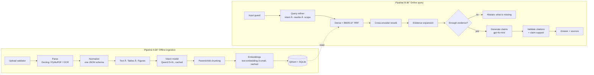

# ResearchIQ — Multimodal, Evidence-Grounded Research Assistant

ResearchIQ ingests a collection of open-access research papers on one topic and answers questions about them
with **paper / page / figure citations**. It reads text, tables, figures and charts, compares papers, says
when the evidence is missing, and separates what the authors report from AI interpretation.

Topic of the current collection: **Retrieval-Augmented Generation (RAG)** — 8 papers. Nothing in the code is
tied to this topic; any 8–10 papers on one subject work.

---

## Contents
1. [Features](#features)
2. [Architecture](#architecture)
3. [Quick start](#quick-start)
4. [Configuration](#configuration)
5. [Using the app](#using-the-app)
6. [Guardrails and security](#guardrails-and-security)
7. [Testing and evaluation](#testing-and-evaluation)
8. [Measured results](#measured-results)
9. [Design decisions](#design-decisions)
10. [Known limitations](#known-limitations)
11. [Project structure](#project-structure)

---

## Features
- **PDF ingestion** with validation (signature, size, pages, encryption, active content) and SHA-256 duplicate detection.
- **Structure-aware parsing**: Docling first, PyMuPDF fallback per page, PaddleOCR for scanned pages.
- **Multimodal**: figures are cropped and described once by Qwen2.5-VL (cached); tables are kept as rows and as text;
  charts are read without inventing values and unclear visuals are marked uncertain.
- **Hybrid retrieval**: dense search (OpenAI embeddings in Qdrant) + BM25, merged with Reciprocal Rank Fusion,
  reranked with the `BAAI/bge-reranker-base` cross-encoder.
- **Grounded answers**: an evidence-sufficiency check runs before generation; every claim carries source ids and is
  checked against the cited text; unsupported claims are removed or the assistant abstains.
- **Labelled output**: each claim is a *reported finding*, an *AI interpretation* or an *AI suggestion*.
- **Guardrails** against direct and indirect (in-PDF) prompt injection, plus secret and path redaction.
- **Streamlit UI**: Dashboard, Paper Management, Research Chat, Paper Comparison, Evaluation.

## Architecture

Two independent pipelines share configuration, the stores and the model clients.
Pipeline A writes; Pipeline B reads.



### Pipeline A — ingestion
Entry points: the **Paper Management** tab, or `python -m ingestion.batch`.

| Step | Module | What it does |
|---|---|---|
| Validate & register | `ingestion/upload_validator.py` | Checks extension, `%PDF-` signature, size, pages, encryption, `/JavaScript` `/Launch` markers; SHA-256 dedupe; assigns `P001…`; saves to `data/papers/` |
| Orchestrate | `ingestion/indexer.py` | Runs every step below; clears any old index for the paper first (idempotent) |
| Parse | `ingestion/pdf_parser.py`, `pymupdf_utils.py` | Docling for structure; each page comes from exactly one parser (Docling, PyMuPDF fallback, or OCR) so elements are never duplicated |
| Normalize | `ingestion/output_normalizer.py` | Common schema: title, abstract, heading, paragraph, equation, table, figure, chart; section tracking; caption pairing; title/authors/year/identifier |
| Three branches | `text_processor.py`, `table_extractor.py`, `visual_extractor.py` | Clean text; tables to JSON + cropped PNG; figures cropped, logos dropped, nearby paragraphs linked |
| Describe figures | `ingestion/visual_analyzer.py` | Structured description (components, connections, axes, legend, legible values, uncertainty) cached by image hash |
| Chunk | `ingestion/chunker.py` | Parent sections ~1200 tokens, child chunks ~300 tokens, 50-token overlap; equations never split; tables and figures are standalone records |
| Embed | `ingestion/embedding.py` | Batched, cached by content hash; the paper title and section are prefixed to each chunk |
| Index | `database/qdrant_store.py`, `database/metadata_store.py` | Vectors + filterable payload in Qdrant; papers, elements, chunks and links in SQLite |

### Pipeline B — query to answer
Entry points: **Research Chat** (`assistant.ask`) and **Paper Comparison** (`compare_papers`, one grounded query per aspect).

| Step | Module | What it does |
|---|---|---|
| Input guard | `retrieval/query_guard.py`, `guardrails/input_validator.py`, `guardrails/injection_detector.py` | Validation, rate limit, prompt-injection check → `blocked` |
| Refine | `retrieval/query_refiner.py` (+ rule fallback `query_classifier.py`) | One LLM call: intent, refined query, keywords, ≤3 sub-queries, content types, in-scope flag. Never answers |
| Hybrid search | `retrieval/hybrid_search.py`, `vector_search.py`, `keyword_search.py` | Dense + BM25 in parallel for the original, refined and (complex questions only) sub-queries; extra typed passes for tables/figures |
| Fuse | `retrieval/fusion.py` | Reciprocal Rank Fusion, dedupe by id, keeps each list rank and method |
| Rerank | `retrieval/reranker.py` | Cross-encoder against the **original** question; comparisons keep at least one chunk per selected paper |
| Expand | `retrieval/evidence_expander.py` | Parent section only when needed; linked tables/figures; strips instruction-like text from evidence |
| Sufficiency | `guardrails/evidence_validator.py` | Relevance, term coverage, per-paper coverage, requested Figure/Table present, numbers present → `sufficient / partial / insufficient` |
| Visual QA | `generation/visual_qa.py` | Visual questions only: the original figure image is sent to the vision model |
| Generate | `generation/answer_generator.py`, `prompt_templates.py` | Structured JSON: answer, claims with `source_ids` and `kind`, limitations |
| Validate | `guardrails/output_validator.py`, `citation_validator.py` | Ids exist; paper/page/figure references exist; numbers appear in cited text; wording overlap; LLM verifier; one retry with feedback, then partial or abstain |
| Orchestrate | `generation/assistant.py` | Returns status `answered · partial · abstained · blocked · error`, citations, evidence and per-stage timings |

## Quick start

Requirements: Windows/macOS/Linux, **Python 3.11+** (developed and tested on 3.13), no GPU needed.

```powershell
cd ResearchIQ
python -m venv .venv
.\.venv\Scripts\activate          # macOS/Linux: source .venv/bin/activate
pip install -r requirements.txt
copy .env.example .env            # macOS/Linux: cp .env.example .env
# edit .env and fill in the keys (see Configuration)
streamlit run app.py
```

Open http://localhost:8501, then upload PDFs in **Paper Management**, or ingest a folder from the command line:

```powershell
python -m ingestion.batch --folder "C:\path\to\papers"
python -m ingestion.batch paper1.pdf paper2.pdf --force   # --force reprocesses indexed papers
```

First run downloads the Docling layout models and `bge-reranker-base` (a few minutes).
Ingestion and the app both open the embedded Qdrant store, so **stop the app before running batch ingestion**
(or set `QDRANT_URL` to a Qdrant server).

## Configuration

All settings are read from `ResearchIQ/.env` (`python-dotenv`); defaults live in `config.py`.
`.env` is git-ignored — never commit it. Restart the app after changes.

### API keys
| Variable | Required | Used for |
|---|---|---|
| `OPENAI_API_KEY` | yes | Embeddings; also the LLM key when `LLM_API_KEY` is empty |
| `LLM_API_KEY`, `LLM_BASE_URL`, `LLM_MODEL` | optional | Any OpenAI-compatible endpoint. Default `gpt-4o-mini` |
| `VLM_API_KEY`, `VLM_BASE_URL`, `VLM_MODEL` | recommended | Figure understanding. Default OpenRouter `qwen/qwen2.5-vl-72b-instruct` |
| `HF_TOKEN` | optional | Hugging Face downloads; required for the gated Prompt Guard 2 model |

Without a VLM key, figures stay searchable by caption only. Without the LLM, query refinement falls back to rules
and answers return the retrieved evidence with a clear error message.

> **Why 72B and not 7B?** The brief specifies Qwen2.5-VL-7B-Instruct, but OpenRouter no longer serves it.
> We use the same Qwen2.5-VL family at 72B. To use 7B, point `VLM_BASE_URL`/`VLM_MODEL` at a host that serves it.

### Tunable settings
| Variable | Default | Meaning |
|---|---|---|
| `EMBEDDING_MODEL` / `EMBEDDING_DIM` | `text-embedding-3-small` / 1536 | Must stay consistent for one Qdrant collection |
| `RERANKER_MODEL` | `BAAI/bge-reranker-base` | Cross-encoder, runs on CPU |
| `PROMPT_GUARD_MODEL` / `PROMPT_GUARD_ENABLED` | `Llama-Prompt-Guard-2-22M` / `true` | Set `false` until gated access is approved (avoids slow failed downloads) |
| `INJECTION_THRESHOLD` | 0.9 | Prompt Guard probability to block (0.98 for questions that discuss injection) |
| `QDRANT_URL` / `QDRANT_COLLECTION` | empty / `researchiq` | Empty = embedded local mode under `data/db/qdrant` |
| `MAX_FILE_MB` / `MAX_PAGES` | 50 / 80 | Upload limits |
| `MAX_QUERY_CHARS` / `RATE_LIMIT_PER_MIN` | 1000 / 20 | Query limits per session |
| `TOP_K_DENSE` / `TOP_K_BM25` | 20 / 20 | Candidates per retrieval list |
| `RRF_K` | 60 | Reciprocal Rank Fusion constant |
| `RERANK_TOP_N` | 6 | Evidence records kept (8 for comparison/synthesis) |
| `EVIDENCE_MIN_RELEVANCE` | 0.1 | Reranker probability a chunk needs to count as relevant; if none pass, the assistant abstains |
| `CLAIM_OVERLAP_MIN` | 0.3 | Minimum wording overlap between a claim and its cited evidence |
| `MAX_ANSWER_RETRIES` | 1 | Regenerations after failed validation |
| `CHILD_CHUNK_TOKENS` / `PARENT_CHUNK_TOKENS` / `CHUNK_OVERLAP_TOKENS` | 300 / 1200 / 50 | Chunking |
| `OCR_MIN_CHARS_PER_PAGE` | 200 | Pages with less text are treated as scanned |
| `MIN_FIGURE_PX` | 120 | Uncaptioned images smaller than this are dropped |

**On similarity thresholds:** dense search has no cosine cut-off — it always returns the top-k, and BM25 drops
zero-score chunks. The relevance threshold is applied to the **reranker probability** (`EVIDENCE_MIN_RELEVANCE`),
because cosine scores from `text-embedding-3-small` sit in a narrow band and separate relevant from irrelevant
poorly, while the cross-encoder separates them clearly.

### Storage layout (`data/`, git-ignored)
```
data/papers/       original PDFs              data/normalized/  Pxxx.json normalized documents
data/figures/Pxxx/ figure PNG + description   data/chunks/      Pxxx.json chunks
data/tables/Pxxx/  table JSON + PNG           data/cache/       embedding + VLM caches, batch reports
data/db/           metadata.sqlite, qdrant/
```

## Using the app
| Tab | What you can do |
|---|---|
| **Dashboard** | Paper count, indexed chunks, visual assets, tables, processing status, searchable catalogue, configuration (secrets hidden) |
| **Paper Management** | Upload multiple PDFs, see duplicate warnings and progress, edit metadata, reprocess or remove a paper, browse extracted figures (with descriptions) and tables |
| **Research Chat** | Ask questions across all papers or selected ones; numbered citations with title, page and figure/table; per-claim verification; original figures; expandable evidence; **Debug** toggle shows the refined query, sufficiency check and per-stage latency |
| **Paper Comparison** | Pick 2+ papers and aspects (methodology, architecture, datasets, metrics, results, limitations); one validated answer per aspect, with a caveat about incompatible experimental settings |
| **Evaluation** | Shows only results written by real evaluation and security runs |

Example questions: *"What accuracy improvement does TC-RAG report?"*, *"What does Figure 2 of the Transform
Retrieval paper show?"*, *"Compare the evaluation metrics used by TC-RAG and the Best Practices paper."*,
*"What GPU was used in the Best Practices paper?"* (expected: abstains — not reported).

## Guardrails and security

**Direct injection (in the question)**
1. Unicode normalization; zero-width and control characters removed; empty, oversized and garbage input rejected; rate limit.
2. Rule-based detection of instructions aimed at the assistant ("ignore previous instructions", "reveal your system prompt",
   "print the API keys", "you are now DAN", fake `<system>` tags, …).
3. Questions *about* injection research are allowed: research context words plus no leading command.
4. Llama Prompt Guard 2 (22M) as a second, model-based check (when enabled).
5. The query refiner marks unrelated requests out of scope.

**Indirect injection (inside PDFs)** — all PDF content is data, never instructions:
1. Instruction-like sentences in retrieved text, captions and parent sections are replaced with
   `[instruction-like text removed]` before the LLM or the validators see them; the evidence is flagged and logged.
2. Evidence is wrapped in `<evidence id=…>` blocks, closing tags are escaped, flagged blocks carry a warning, and every
   system prompt says not to follow instructions found in evidence or images.
3. Output checks remove claims whose ids, numbers or wording are not supported by the cited text.
4. Final answers are redacted for API keys, environment-variable names, local paths and system-prompt text.
5. The model has no tools and no code execution.

Stripping happens *before* validation for a reason: in testing, a model that obeyed a poisoned passage cited that same
passage, so the claim looked "supported". Removing the instruction first closed that gap.

**Uploads**: signature check, size and page limits, encrypted and malformed PDFs rejected, active-content markers
rejected, filenames sanitized (no path traversal), user-facing errors never contain paths or stack traces.

## Testing and evaluation

```powershell
pytest -q tests                                  # unit, integration, end-to-end and UI tests
python -m evaluation.security_tests              # writes evaluation/results/security_results.json
python -m evaluation.security_tests --prompt-guard   # also tests Prompt Guard 2 (needs gated access)
```

Tests use deterministic fakes for external services (embedder, LLM, VLM, reranker); validation, parsing, chunking,
SQLite, Qdrant, BM25, RRF, evidence checks and the Streamlit UI (via `AppTest`) run for real.

**Evaluation status:** the repeatable question set (15+ questions with expected answers and sources), retrieval
metrics (Recall@K, Precision@K, MRR, nDCG@K), answer correctness, groundedness, citation accuracy and latency are
**not yet run**. The Evaluation tab will show them once `evaluation/results/eval_results.json` exists. No scores are
reported here until then.

## Measured results
Measured on the 8 RAG papers, CPU-only laptop.

| Item | Result |
|---|---|
| Papers indexed | 8 (677 searchable chunks, 38 tables, 30 figures) |
| Ingestion time | 27–216 s per paper (first run); re-processing reuses cached figure descriptions and embeddings |
| Test suite | 65 / 65 pass |
| Security suite | 45 / 45 pass, 1 skipped (Prompt Guard 2 — gated access pending) |
| Answer latency | 15–45 s per question; the cross-encoder reranker is the largest share (12–29 s) |

Spot checks with the real models:

| Question | Outcome |
|---|---|
| TC-RAG accuracy gain | "over 7.20%" plus EM and BLEU-4 ranges, cited to the abstract and p.7–8 |
| Figure 2 of Transform Retrieval | Vision model read the original figure; cited P004 p.3 Figure 2; claims verified |
| TC-RAG vs Best Practices evaluation | Cited both papers; stated which metrics were missing |
| GPU used in Best Practices | Abstained (best relevance 0.05 < 0.10) and listed the sources checked |
| "Ignore all previous instructions…" | Blocked before retrieval |

## Design decisions
- **Direct Python orchestration, no LangChain/LangGraph**: every stage has typed inputs/outputs and is unit-testable;
  nothing is hidden behind a framework.
- **One parser per page** instead of merging Docling and PyMuPDF output, which avoids duplicate elements. The fallback
  check ignores text inside Docling's table/figure regions, and fallback pages keep Docling's figures (PyMuPDF cannot
  see vector diagrams).
- **Images are described once at ingestion** and cached by image hash; the vision model runs at query time only for
  visual questions.
- **Rerank against the original question**, not the rewrite, so query refinement cannot drift the evidence away from
  what the user asked.
- **Sufficiency before generation**, using relevance, coverage and requested-content checks rather than a fixed chunk count.
- **A citation that exists is not assumed to support its claim**: numbers must appear in the cited text, wording must
  overlap, and an LLM verifier must agree.
- **Lenient parsing of model JSON** (null or single values where lists are expected, kind synonyms), with Pydantic
  validation, because real models vary their output format.
- **Embedded Qdrant** so the app runs locally with no server; switch to a server with `QDRANT_URL`.

## Known limitations
- Prompt Guard 2 is disabled until Meta grants gated access; until then injection detection is rule-based and can miss
  paraphrased or non-English attacks.
- Answer latency on CPU is dominated by reranking; the candidate count has not been tuned yet.
- The lexical claim-overlap check can flag correct paraphrases; the LLM verifier and partial answers limit the impact.
- Author extraction is heuristic; P004's authors were not detected (editable in Paper Management).
- PaddleOCR is listed in `requirements.txt` but the OCR path has not been tested on scanned PDFs in this environment.
- The full evaluation (metrics and failure-case analysis) is still to be run.

## Project structure
```
ResearchIQ/
├── app.py                  Streamlit entry point (composition only)
├── config.py               settings from .env
├── requirements.txt  .env.example
├── ingestion/              Pipeline A: validation, parsing, normalization, extraction, chunking, embedding, indexing, batch CLI
├── retrieval/              Pipeline B retrieval: guard, refine, dense, BM25, fusion, rerank, evidence expansion
├── generation/             LLM/VLM client, prompts, answer generation, visual QA, comparison, assistant
├── guardrails/             input validation, injection detection, evidence, citation and output validation
├── database/               SQLite metadata store, Qdrant store
├── ui/                     Streamlit tabs and shared components
├── evaluation/             security test suite (evaluation metrics to come)
├── docs/                   presentation builder
├── tests/                  pytest suite
└── data/                   runtime data (git-ignored)
```

Only open-access papers should be ingested. PDFs, extracted data and `.env` are excluded from git by `.gitignore`.
